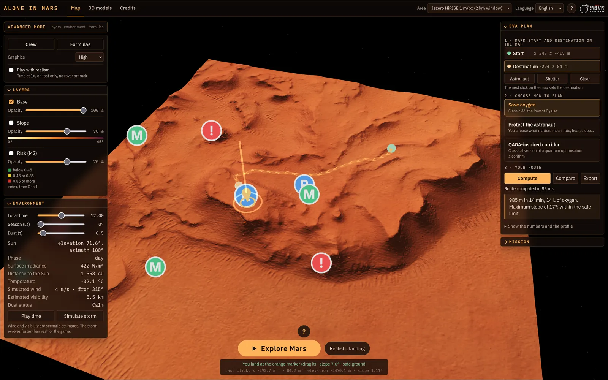
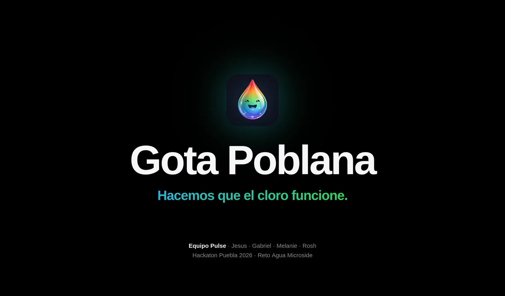
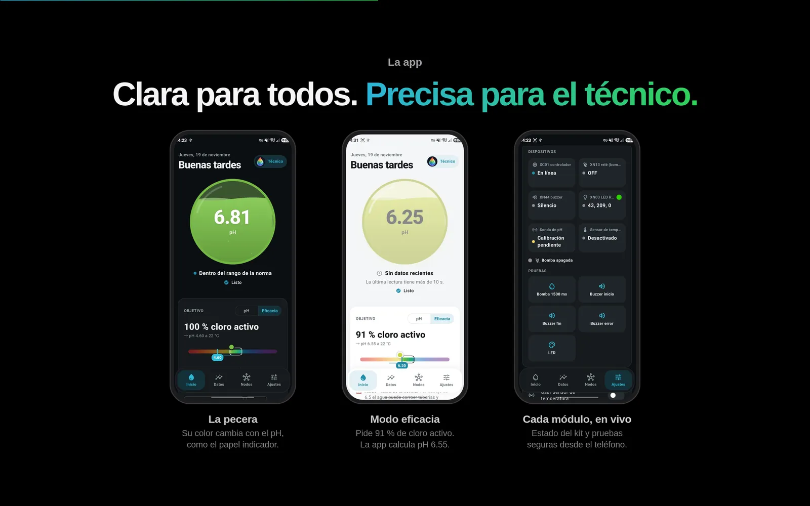
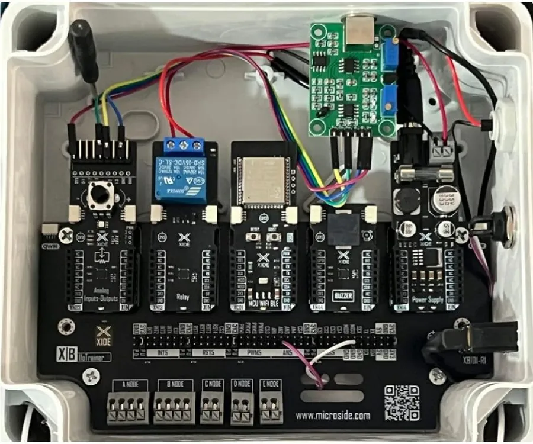
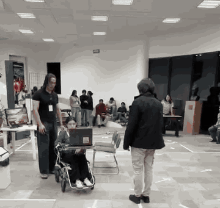

<a href="https://roshtzsche.github.io">
  <picture>
    <source media="(prefers-color-scheme: light)" srcset="assets/banner-light.svg">
    
  </picture>
</a>

 

---

## About

Biomedical Engineering student at **UDLAP** (Honors Program), from Durango, studying in Puebla, Mexico.
I work where **nonlinear dynamics, brain signals and AI** meet, and I like building the hardware and the apps around them.
Member of the **UDLAP STEM representative team**. Also: math olympiads, chess, and Linux *ricing*.

## Highlights

| | |
| :-- | :-- |
| **Greatest Technological Innovation**, NASA Space Apps Puebla 2026 | [MarsWalker](https://github.com/RoshTzsche/mars_walker) |
| **2nd place**, Hackatón Puebla 2026 | [Gota Poblana](https://github.com/RoshTzsche/gota_poblana) |
| **2nd place national**, Swift Social Change Makers · Enactus 2025 | [Ojo de Halcón](https://github.com/RoshTzsche/ojo_de_halcon) |
| **Talk** at MUTVI 4: *The shape of consciousness*, Takens' theorem on neural dynamics | [watch](https://www.youtube.com/watch?v=H2ynSl1nyjo) |
| **Putnam 2026** UDLAP representative · OMUM 2026 · national bronze, XXXI Chemistry Olympiad | |

## Selected projects

### [MarsWalker](https://github.com/RoshTzsche/mars_walker)
**Greatest Technological Innovation** · NASA Space Apps Challenge, Puebla 2026

Walking on Mars before going there. A browser 3D simulator of crewed missions in **Jezero Crater**, built on real **HiRISE** elevation data.
It plans routes from terrain slope, suit oxygen use and crew physiology, so a mission team can compare paths before anyone sets foot on them.

 

### [Gota Poblana](https://github.com/RoshTzsche/gota_poblana)
**2nd place** · Hackatón Puebla 2026

<table>
<tr>
<td width="62%"></td>
<td width="38%"></td>
</tr>
</table>

Safer water, one drop of acid at a time. An **ESP32-S3** controls pH for water chlorination: temperature-compensated sensing, a dose size it learns from each previous dose, and a **Flutter** app over **MQTT** to watch it live.

 

### [MOVA](https://github.com/RoshTzsche/mova)
**Competed at Sillódromo 2026** · INAOE

<table>
<tr>
<td width="46%" valign="top"></td>
<td width="54%" valign="top">

Driving a wheelchair with your face.

**MediaPipe** landmarks and head pose become movement commands sent to the chair over USB serial.
Each user gets their own calibration, and a short temporal confirmation filters out accidental moves, so a glance to the side doesn't turn the chair.

The clip: MOVA on the course at Sillódromo 2026 (2.5× speed).

</td>
</tr>
</table>

 

### More projects

| | |
| :-- | :-- |
| [`fruticebada`](https://github.com/RoshTzsche/fruticebada) | Predicting barley harvest from satellite and climate data, with a SHAP map · [live demo](https://frutiloopsfira.onrender.com) |
| [`ojo_de_halcon`](https://github.com/RoshTzsche/ojo_de_halcon) | Real-time football tactics in SwiftUI · 2nd place national, Enactus 2025 |
| [`eeg_phase_space`](https://github.com/RoshTzsche/eeg_phase_space) | The hidden geometry of a brain signal: delay embedding, AMI and FNN |
| [`ct_neuro_viewer`](https://github.com/RoshTzsche/ct_neuro_viewer) | DICOM to Hounsfield volumes, orthogonal views and MIP |
| [`metagenomics_kraken`](https://github.com/RoshTzsche/metagenomics_kraken) | What a crayfish eats, read from its DNA |
| [`logic_lectures`](https://github.com/RoshTzsche/logic_lectures) | Logic, sets and Gödel: 7 lectures I gave to classmates |
| [`dotfiles`](https://github.com/RoshTzsche/dotfiles) | CachyOS + Hyprland (Lua config), Waybar, Neovim for science |

Every project with its full story at <a href="https://roshtzsche.github.io/en/#projects"><b>roshtzsche.github.io</b></a>

## Stack

## Elsewhere

[Website](https://roshtzsche.github.io) ·
[Attractor lab](https://roshtzsche.github.io/en/lab/) ·
[Writing](https://roshtzsche.github.io/en/writing/) ·
[Play chess with me](https://roshtzsche.github.io/en/chess/) ·
[STEMpire podcast](https://youtube.com/@stemudlap) (occasional co-host) ·
[LinkedIn](https://www.linkedin.com/in/rosh-guadiana) ·
[ORCID](https://orcid.org/0009-0007-0324-3939) ·
[CV](https://roshtzsche.github.io/cv.pdf)

 
<a href="https://roshtzsche.github.io"><b>roshtzsche.github.io</b></a>
  
roshguadiana@gmail.com · UDLAP · Puebla, MX
  

<code>cat .secret</code>

 

 
you found the cat. now go see the <a href="https://roshtzsche.github.io">rest</a>.

