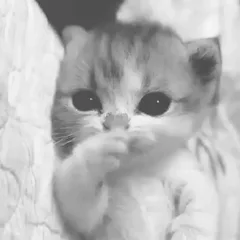

<a href="https://roshtzsche.github.io">
  <picture>
    <source media="(prefers-color-scheme: light)" srcset="assets/banner-light.svg">
    
  </picture>
</a>

 

---
Holaa, Hello!
I'm a Biomedical Engineering student at **UDLAP**, born in Durango, Mexico 🇲🇽.
I like math, brain signals, chemistry, chess and Linux *ricing*.

* **Born on** February 14th.
* **Bronze medal** at the XXXI National Chemistry Olympiad.
* **Taught** logic, sets and Gödel to my classmates, and gave talks at *Noche de las Estrellas*.
* **Built** a wheelchair you drive with your face ([MOVA](https://github.com/RoshTzsche/mova)).
* **Occasional co-host** of the STEMpire podcast on [YouTube](https://youtube.com/@stemudlap).
* **OS:** CachyOS + Hyprland, configured in Lua ([dotfiles](https://github.com/RoshTzsche/dotfiles)).
* ♟️ **Let's play some chess:** [chess.com](https://www.chess.com/member/ugapor) · [lichess](https://lichess.org/@/DracoKerouac)

 
<a href="https://roshtzsche.github.io"><b>roshtzsche.github.io</b></a>
  
roshguadiana@gmail.com · UDLAP · Puebla, MX
  

<code>cat .secret</code>

 

 
you found the cat. now go see the <a href="https://roshtzsche.github.io">rest</a>.

